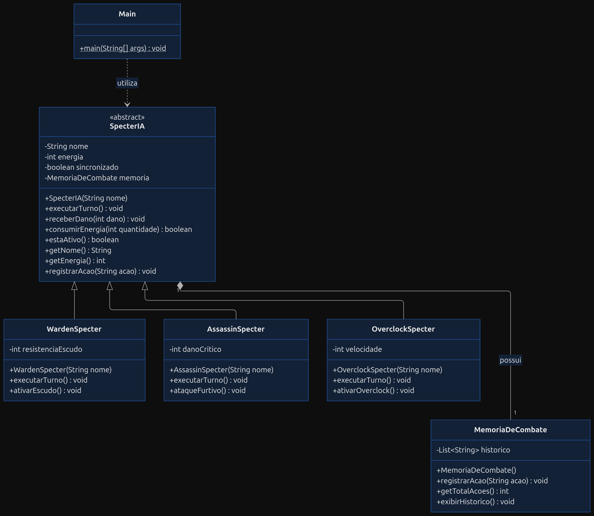
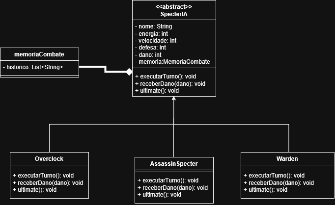

# Specter League — Night Patch Cell

## Sobre o projeto

A Specter League é um protótipo desenvolvido em Java para representar agentes de inteligência artificial que participam de duelos.

O objetivo é substituir uma estrutura baseada em um grande `switch` por uma arquitetura orientada a objetos, facilitando a manutenção, a organização e a expansão do sistema.

## Equipe e papéis XP

- **Nome do grupo:** Specter Core
- **Driver:** Ana Clara Ferreira Clarette
- **Navigator:** Eduardo Guaglione Lupianez
- **Tracker:** Pedro Ludovic Nascimento Lima 
- **Coach:** Bruno Rafael Gonçalvez
- **IA Operator:** Miguel Pereira Soares 

## Modelagem proposta

A arquitetura utiliza cinco conceitos fundamentais de Programação Orientada a Objetos:

- **Abstração:** a classe abstrata `SpecterIA` define características compartilhadas e o contrato do método `executarTurno()`.
- **Encapsulamento:** atributos sensíveis, como energia e estado de sincronização, são privados e protegidos por métodos.
- **Herança:** `WardenSpecter` e `AssassinSpecter` herdam características de `SpecterIA`.
- **Polimorfismo:** cada tipo de Specter implementa `executarTurno()` de maneira diferente, permitindo chamar o método por uma referência da classe base.
- **Composição:** cada Specter possui uma `MemoriaDeCombate`, responsável por armazenar informações sobre suas ações.

## Por que escolhemos uma classe abstrata?

Escolhemos uma classe abstrata porque os Specters compartilham atributos de instância, como energia, estado de sincronização e memória de combate.

Diferentemente de uma interface, a classe abstrata permite centralizar esse estado e compartilhar implementações, evitando duplicação de código.

O método abstrato `executarTurno()` garante que cada subclasse implemente seu próprio comportamento.

## Utilização de IA generativa

**Ferramenta:** ChatGPT

**Papel da IA:** auxiliar na identificação das classes, comparação de alternativas de arquitetura e revisão dos conceitos de POO.

### Prompt utilizado

"Atue como um analista de arquitetura de software especializado em Java. Analise o problema da Specter League e sugira uma modelagem utilizando encapsulamento, herança, polimorfismo, abstração e composição. Compare classe abstrata e interface e explique como separar os Specters de sua memória de combate. Não gere código Java."

### Ajuste realizado na sugestão da IA

Geramos um diagrama de classes utilizando a IA porém sua primeira versão não ficou boa, mas a mesma serviu como modelo para o diagrama final do grupo.

## Diagrama de classes Grupo VS IA

## Tecnologias

- Java
- Git e GitHub
- ChatGPT como ferramenta de apoio
